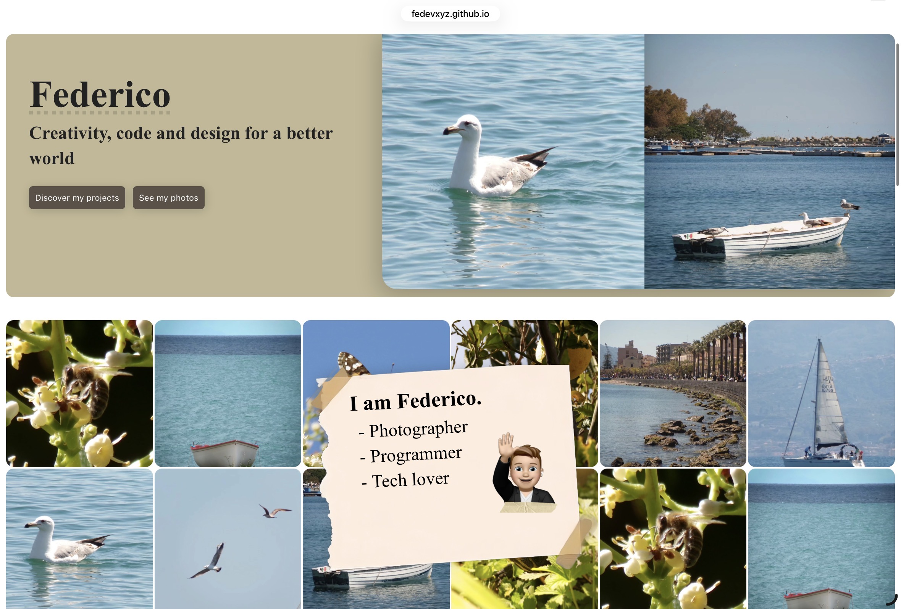

# MyGreatPortfolio

MyGreatPortfolio is my first personal portfolio website, created to showcase my projects and share my interests in programming, photography, and technology.

## Preview



## About the Project

I built this website to put my web development skills into practice and create a personal space to present my work. It was an opportunity to experiment with HTML, CSS, JavaScript, and web design while learning how to turn my ideas into a working project. I’m also participating in Hack Club Terra, a YSWS (you ship we ship) program by Hack Club.

The portfolio includes a personal introduction, a photography section, and projects such as CleanBench PSU, Didup Plus, and D-Desk.

## Technologies

- HTML5
- CSS3
- JavaScript
- Webpack 5
- npm

## Getting Started
- Open the [Github Pages website](https://fedevxyz.github.io/MyGreatPortfolio)

or
- Serve in localhost
Make sure you have [Node.js](https://nodejs.org/) and npm installed.

Clone the repository and install the dependencies:

```bash
git clone https://github.com/fedevxyz/mygreatportfolio.git
cd mygreatportfolio
npm install
```

Start the development server:

```bash
npm start
```

To build the project for production:

```bash
npm run build
```

## Past versions

This project is an update of MyCoolPortfolio, and they are the starting of my journey in personal web development. You can find MyCoolPortfolio here: [MyCoolPortfolio](https://github.com/fedevxyz/mycoolportfolio) 

## Author

**Federico (FeDevXYZ)**

- [GitHub Profile](https://github.com/fedevxyz)
- [Instagram Profile](https://instagram.com/fe_.space)
